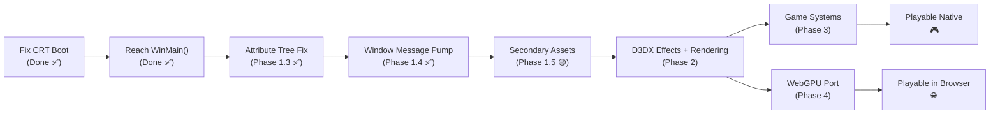

# Roadmap: ProStreet Running Natively on Linux & in the Browser

> This is the actionable plan to get from the current state (WinMain running, asset streaming active, attribute tree parsing) to a playable game — first natively on Linux, then in the browser via WebGPU.

---

## Where We Are Now

```
x86 → C lift ✅  55,175 functions lifted
Runtime build ✅  compiles clean with -Werror (STRICT=1)
Imports bound ✅  371/371 across 15 DLLs
Shader pipeline ✅  591/591 D3D9 → WGSL, all validate
D3D9 HLE ✅  device + buffers + draw + textures + offline software rasterizer (swrast)
D3DX Effects ✅  all 34 effects parsed, preshaders (PRES) executed, parameter binding
WebGPU triangle ✅  renders in Chrome
Web build ✅  compiles to 57 MB .wasm
CRT start-up ✅  completes (unpacked image post-load state)
main() ✅  WinMain entered & running (0x004afee0)
D3D9 / DisplayDevice ✅  initialized (pDev=0x4c0001f0, 0x032a5fc0)
Asset Loading ✅  GLOBALA.BUN mounted, ATTRIBUTES.BIN parsed, car geometries/textures loaded
Dump-state repair ✅  zeroing fallback & list head table support retail/repack installs
Window message pump ✅  PeekMessageA/GetMessageA/DispatchMessageA host pump implemented
D3D9/D3DX lifecycle ✅  BeginScene/EndScene/Present & ID3DXEffect pass lifecycle ticking
Native game flow ✅  scripted run: profile creation, main menu, Race Day event, into the race
Offline frame render ✅  swrast renders 3D frames to .ppm files (e.g. out/frame_300_rt*.ppm)

Current front 🟡  Live window display (SDL2/Vulkan) & AEMS audio modules
Game systems 🟡  headless input, menus and racing working; live display & audio not started
```

---

## Phase 1 — Fix the Boot & Window Pump (Native Linux) ✅ COMPLETED

**Goal:** `./out/prostreet` runs past CRT init, enters `WinMain`, loads base assets, and begins frame pumping.

### 1.1 CRT Startup & Constructor Initialization ✅ DONE
In the unpacked memory image (`artifacts/nfs.exe.unpacked`), the C runtime startup state (`0x100f4c4`) is loaded in its post-load initialized state (`2`). `_WinMainCRTStartup` completes cleanly without crashing.

### 1.2 Reach `WinMain()` ✅ DONE
`WinMain` entered at `0x004afee0`. Background worker threads active; EA filesystem initialized.

### 1.3 Attribute Tree & Asset Loading ✅ DONE
All 251 attributes complete validation cleanly. Secondary asset archives (`L6R_FE.BUN`, `FRONTDLC.BUN`, `STREAML6R_FE.BUN`) and car packages (`CARS/LANCEREVOX`, `CARS/MUSTANGGT`) mount cleanly.

### 1.4 Window Message Pump & D3D9 Present ✅ DONE
`CreateWindowExA` and message loop pumping (`PeekMessageA`, `GetMessageA`, `DispatchMessageA`) implemented. D3D9 device scene lifecycle (`BeginScene`, `EndScene`, `Present`) ticks continuously past thousands of frames.

---

## Phase 2 — Rendering & D3DX Effects (Native Linux) 🟡 IN PROGRESS

**Goal:** Game effects are evaluated and rendered on Linux.

### 2.1 D3DX Effect System ✅ DONE
- [x] All 34 ProStreet compiled effects parse to completion (`lifter/runtime/d3dx_effect.c`).
- [x] Preshader interpreter (PRES) implemented and verified against Wine D3DX9 specs.
- [x] Effect parameter-to-register bindings, techniques, and passes active.
- [x] D3DX math functions implemented and covered by unit tests.

### 2.2 Offline Software Rasterizer ✅ DONE
- [x] Software rasterizer (`lifter/runtime/swrast.c`) renders 3D draw calls offline.
- [x] Frames dumped to `.ppm` files via `PROSTREET_FRAMEDUMP=<frame>`.

### 2.3 Live Display Window (CURRENT FRONT)
- [ ] Connect `d3d9_hle.c` / `win32.c` `Present()` to a live desktop window (SDL2, Vulkan, or X11/OpenGL) rather than headless/offline PPM rendering.

---

## Phase 3 — Game Systems & Interactivity (Native Linux) 🟡 IN PROGRESS

**Goal:** The game is fully playable with screen, gamepad, and audio.

| System | State | Details |
|---|---|---|
| **Scripted Input** | ✅ Working | DirectInput scripted inputs (`PROSTREET_SCRIPT`) drive menus, car steering, acceleration |
| **Interactive Input** | 🟡 Next | Wire real physical keyboard and gamepad (evdev / SDL_GameController) |
| **Menus & Flow** | ✅ Working | Title screen, profile creation dialog, main menu, Race Day event selection |
| **Race Engine** | ✅ Working | Transitions to game flow 6 (racing), car physics simulation active |
| **Audio** | ❌ Not started | EA's proprietary AEMS modules in sound data need lifting or HLE replacement |

| Task | File(s) | Details |
|---|---|---|
| Implement `SetVertexShader` / `SetPixelShader` → track active shader | `lifter/runtime/d3d9_hle.c` | Store the shader handle; apply it at draw time |
| Implement `SetRenderState`, `SetSamplerState`, `SetTextureStageState` → track state | `lifter/runtime/d3d9_hle.c` | State table, applied at draw time |
| Implement `DrawPrimitive` / `DrawIndexedPrimitive` → render via OpenGL/Vulkan | `lifter/runtime/d3d9_hle.c` | Use SDL2 + OpenGL 3.3 (or Vulkan) as the native backend; translate vertex/index buffers |
| Implement `CreateVertexBuffer` / `CreateIndexBuffer` / `Lock` / `Unlock` | `lifter/runtime/d3d9_hle.c` | Allocate host-side buffers, map guest pointers |
| Implement `CreateTexture` / `SetTexture` / `LockRect` / `UnlockRect` | `lifter/runtime/d3d9_hle.c` | Load texture data from guest memory into GPU textures |

### 2.3 Shader Execution (Native Path)

| Task | File(s) | Details |
|---|---|---|
| At draw time, translate the active D3D9 shader bytecode → GLSL (or use the CPU interpreter) | `lifter/tools/shader2wgsl.c` (adapt for GLSL) or new `shader2glsl.c` | 591 shaders already parse; need a GLSL backend or use the existing WGSL → naga → SPIR-V pipeline |
| Wire shader constants from `SetVertexShaderConstantF` / `SetPixelShaderConstantF` | `lifter/runtime/d3d9_hle.c` | Copy constant registers to uniform buffers |

**Done when:** `./out/prostreet` renders at least one frame with geometry visible (even if textures/effects are wrong).

---

## Phase 3 — Game Systems (Native Linux)

**Goal:** The game is interactive — menus work, a race loads.

| System | Task | Details |
|---|---|---|
| **File I/O** | Implement `CreateFileA` → map game asset paths to `game/` directory | Already partially done; needs EA's `.bff` archive reading |
| **Audio** | Implement `DirectSoundCreate` / `IDirectSoundBuffer` → SDL_audio or PipeWire | 1 `dsound.dll` import; need buffer creation + playback |
| **Input** | Implement `DirectInput8Create` / `IDirectInputDevice8` → SDL_GameController or evdev | 1 `dinput8.dll` import; keyboard + gamepad |
| **Registry** | Implement `RegOpenKeyExA` / `RegQueryValueExA` → read from `app/registry-defaults.txt` | Already have the defaults file |
| **Networking** | Implement winsock stubs (`ws2_32.dll`, 37 imports) → return errors / no-network | Already implemented; verify LAN code doesn't crash |
| **Menus** | Debug and fix the game's menu init path | Depends on D3D9 HLE + file I/O being functional |

**Done when:** Game reaches main menu, player can navigate menus, and a race loads.

---

## Phase 4 — Browser Port (WebGPU + WebAssembly)

**Goal:** The game runs in a Chromium browser tab using WebGPU.

> This phase builds on Phase 2 — the native D3D9 HLE translates directly to the web runtime.

### 4.1 Web Runtime

| Task | File(s) | Details |
|---|---|---|
| Port CRT constructor fixes to wasm runtime | `web/runtime/` | Same `.data` init fixes from Phase 1 |
| Port `Direct3DCreate9` + `IDirect3DDevice9` to WebGPU backend | `web/runtime/web/gpu_web.c` | Already has encoder + proto infrastructure; wire up device creation |
| Port D3DX HLE to wasm | `web/runtime/web/` (new files) | Same C code, compiled to wasm |
| Wire shader pipeline: D3D9 bytecode → WGSL (already done!) → WebGPU pipeline | `web/src/gpu/encoder.ts`, `web/src/gpu/wgsl.ts` | 591 shaders already translate; need to hook into the draw path |

### 4.2 Asset Delivery

| Task | File(s) | Details |
|---|---|---|
| Serve game files via the web server | `web/start.sh` | Already serves `game/` directory; need to handle `.bff` archive reads |
| Implement OPFS-based caching for game assets | `web/src/app/` | Cache extracted assets in browser storage |

### 4.3 Audio & Input

| Task | File(s) | Details |
|---|---|---|
| Implement Web Audio API backend | `web/runtime/web/audio_web.c`, `web/src/app/` | Replace DirectSound with Web Audio |
| Implement keyboard/gamepad input via browser APIs | `web/runtime/web/input_web.c`, `web/src/app/controls.ts` | Replace DirectInput with `KeyboardEvent` / Gamepad API |

### 4.4 Performance

| Task | Details |
|---|---|
| Profile WASM memory usage (4 GB limit) | 23 MB image + game assets must fit in wasm linear memory |
| Optimise shader compilation (591 shaders) | Pre-compile pipeline cache; lazy-load shaders |
| Multi-threaded execution | SharedArrayBuffer + Web Workers for game thread vs render thread |

**Done when:** Game runs in Chrome/Firefox, main menu is navigable, a race renders at >1 FPS.

---

## Phase 5 — Polish & Playability

| Task | Details |
|---|---|
| Frame rate optimisation | Target 30+ FPS in browser |
| Save/load game state | LocalStorage or IndexedDB |
| Full shader correctness | Per-shader rendered-output comparison against reference |
| Missing D3D9 features | Render targets, stencil, multi-pass effects |
| Sound mixing | Positional audio, engine sounds, music |
| Networking | LAN multiplayer via WebRTC (stretch goal) |

---

## Critical Path Summary



> **Current status**: Phase 1.3 (attribute tree validation via `sub_005310e0_impl` safe override in `g_dtab`) and Phase 1.4 (Win32 window message pump and D3D9/D3DX scene lifecycle) are resolved. Execution advances into Phase 1.5 (secondary asset processing and engine scene initialization).
