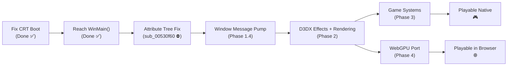

# Roadmap: ProStreet Running Natively on Linux & in the Browser

> This is the actionable plan to get from the current state (WinMain running, asset streaming active, attribute tree parsing) to a playable game — first natively on Linux, then in the browser via WebGPU.

---

## Where We Are Now

```
x86 → C lift ✅  47,514 functions lifted
Runtime build ✅  compiles clean with -Werror (STRICT=1)
Imports bound ✅  371/371 across 15 DLLs
Shader pipeline ✅  591/591 D3D9 → WGSL, all validate
D3D9 HLE ✅  device + buffers + draw + textures (test-level)
WebGPU triangle ✅  renders in Chrome
Web build ✅  compiles to 57 MB .wasm
CRT start-up ✅  completes (unpacked image post-load state)
main() ✅  WinMain entered & running (0x004afee0)
D3D9 / DisplayDevice ✅  initialized (pDev=0x4c0001f0, 0x032a5fc0)
Asset Loading 🟡  GLOBALA.BUN mounted, ATTRIBUTES.BIN parsed (3.2 MB)

Current blocker ⛔  sub_00530f60 (guest_va=0x00000022) in attribute tree
Window message pump ⏳  PeekMessageA/DispatchMessageA host pump needed
D3DX HLE ❌  all 14 imports stubbed (return 0)
Game systems ❌  audio, input, menus, racing — not started
```

---

## Phase 1 — Fix the Boot & Window Pump (Native Linux)

**Goal:** `./out/prostreet` runs past CRT init, enters `WinMain`, loads base assets, creates a host window and begins frame pumping.

### 1.1 CRT Startup & Constructor Initialization ✅ DONE

In the unpacked memory image (`artifacts/nfs.exe.unpacked`), the C runtime startup state (`0x100f4c4`) is loaded in its post-load initialized state (`2`). `_WinMainCRTStartup` completes cleanly without crashing on constructor 13. (Clean on-disk `.data` overlay remains available as an opt-in switch via `PROSTREET_CLEAN_IMAGE`).

### 1.2 Reach `WinMain()` ✅ DONE

- [x] Ensure `_WinMainCRTStartup` → `WinMain` control flow completes
- [x] Verify `GetCommandLineA` / `GetModuleHandleA` return valid pointers
- [x] Added `main-entry` log line in `lifter/runtime/dispatch.c` (`main-entry: WinMain entered (entry 0x004afee0, indirect 0x016beea2)`)
- [x] Background worker threads spawned and active (`sub_00905610`, `sub_008976e4`)
- [x] EA file system initialized, `GLOBAL\GLOBALA.BUN` mounted, `GLOBAL\ATTRIBUTES.BIN` parsed

### 1.3 Attribute Tree & Asset Loading (CURRENT BLOCKER)

| Task | File(s) | Details |
|---|---|---|
| Fix NULL dereference in `sub_00530f60` (`0x00531064`) | `lifter/runtime/dispatch.c` | During `GLOBAL\ATTRIBUTES.BIN` parsing (after 251 attributes inserted), `MR32(esi+4)` is NULL when reading `MR16(edx+0x22)`. Trace caller `sub_005310e0` / `sub_0052eda0`. |
| Verify secondary asset chunks | `scripts/run_boot.sh` | Confirm remaining BUN files (`BOOT.BUN`, `IN_GAME.BUN`) mount cleanly |

### 1.4 Window Message Pump & D3D9 Present

| Task | File(s) | Details |
|---|---|---|
| Implement `CreateWindowExA` → real SDL2/X11 surface or headless container | `lifter/runtime/win32.c` | Return valid HWND, connect to event queue |
| Implement message loop pumping (`PeekMessageA`, `GetMessageA`, `DispatchMessageA`) | `lifter/runtime/win32.c` | Drain OS messages to prevent game thread stall |
| Implement `IDirect3DDevice9::Present` & scene lifecycle | `lifter/runtime/d3d9_hle.c` | Connect `BeginScene` / `EndScene` / `Present` to native window buffer swap |

**Done when:** `./out/prostreet` loads assets, opens a window, and ticks the main loop through `Present()`.

---

## Phase 2 — First Rendered Frame (Native Linux)

**Goal:** A single frame of the game renders to a window on Linux.

### 2.1 D3DX Effect System

| Task | File(s) | Details |
|---|---|---|
| Port `D3DXCreateEffectFromResourceA` from reference | `lifter/runtime/d3dx_hle.c` (new) | Create effect stub object, return fake pointer; reference: `reference/nfsu2-web/runtime/d3dx_hle.c` |
| Port `D3DXCreateEffectPool` | `lifter/runtime/d3dx_hle.c` | Minimal stub |
| Implement `ID3DXEffect::BeginPass` / `CommitChanges` | `lifter/runtime/d3dx_hle.c` | The core render path — sets shader constants, binds textures |
| Implement D3DX math: `D3DXMatrixMultiply`, `D3DXMatrixTranspose`, `D3DXMatrixInverse`, `D3DXMatrixMultiplyTranspose`, `D3DXVec3Transform`, `D3DXVec4Transform` | `lifter/runtime/d3dx_hle.c` | Pure C matrix/vector math — straightforward |

### 2.2 Rendering Pipeline

| Task | File(s) | Details |
|---|---|---|
| Implement `SetVertexShader` / `SetPixelShader` → track active shader | `lifter/runtime/d3d9_hle.c` | Store the shader handle; apply it at draw time |
| Implement `SetRenderState`, `SetSamplerState`, `SetTextureStageState` → track state | `lifter/runtime/d3d9_hle.c` | State table, applied at draw time |
| Implement `DrawPrimitive` / `DrawIndexedPrimitive` → render via OpenGL/Vulkan | `lifter/runtime/d3d9_hle.c` | Use SDL2 + OpenGL 3.3 (or Vulkan) as the native backend; translate vertex/index buffers |
| Implement `CreateVertexBuffer` / `CreateIndexBuffer` / `Lock` / `Unlock` | `lifter/runtime/d3d9_hle.c` | Allocate host-side buffers, map guest pointers |
| Implement `CreateTexture` / `SetTexture` / `LockRect` / `UnlockRect` | `lifter/runtime/d3d9_hle.c` | Load texture data from guest memory into GPU textures |

### 2.3 Shader Execution (Native Path)

| Task | File(s) | Details |
|---|---|---|
| At draw time, translate the active D3D9 shader bytecode → GLSL (or use the CPU interpreter) | `lifter/tools/shader2wgsl.c` (adapt for GLSL) or new `shader2glsl.c` | 591 shaders already parse; need a GLSL backend or use the existing WGSL → naga → SPIR-V pipeline |
| Wire shader constants from `SetVertexShaderConstantF` / `SetPixelShaderConstantF` | `lifter/runtime/d3d9_hle.c` | Copy constant registers to uniform buffers |

**Done when:** `./out/prostreet` renders at least one frame with geometry visible (even if textures/effects are wrong).

---

## Phase 3 — Game Systems (Native Linux)

**Goal:** The game is interactive — menus work, a race loads.

| System | Task | Details |
|---|---|---|
| **File I/O** | Implement `CreateFileA` → map game asset paths to `game/` directory | Already partially done; needs EA's `.bff` archive reading |
| **Audio** | Implement `DirectSoundCreate` / `IDirectSoundBuffer` → SDL_audio or PipeWire | 1 `dsound.dll` import; need buffer creation + playback |
| **Input** | Implement `DirectInput8Create` / `IDirectInputDevice8` → SDL_GameController or evdev | 1 `dinput8.dll` import; keyboard + gamepad |
| **Registry** | Implement `RegOpenKeyExA` / `RegQueryValueExA` → read from `app/registry-defaults.txt` | Already have the defaults file |
| **Networking** | Implement winsock stubs (`ws2_32.dll`, 37 imports) → return errors / no-network | Already implemented; verify LAN code doesn't crash |
| **Menus** | Debug and fix the game's menu init path | Depends on D3D9 HLE + file I/O being functional |

**Done when:** Game reaches main menu, player can navigate menus, and a race loads.

---

## Phase 4 — Browser Port (WebGPU + WebAssembly)

**Goal:** The game runs in a Chromium browser tab using WebGPU.

> This phase builds on Phase 2 — the native D3D9 HLE translates directly to the web runtime.

### 4.1 Web Runtime

| Task | File(s) | Details |
|---|---|---|
| Port CRT constructor fixes to wasm runtime | `web/runtime/` | Same `.data` init fixes from Phase 1 |
| Port `Direct3DCreate9` + `IDirect3DDevice9` to WebGPU backend | `web/runtime/web/gpu_web.c` | Already has encoder + proto infrastructure; wire up device creation |
| Port D3DX HLE to wasm | `web/runtime/web/` (new files) | Same C code, compiled to wasm |
| Wire shader pipeline: D3D9 bytecode → WGSL (already done!) → WebGPU pipeline | `web/src/gpu/encoder.ts`, `web/src/gpu/wgsl.ts` | 591 shaders already translate; need to hook into the draw path |

### 4.2 Asset Delivery

| Task | File(s) | Details |
|---|---|---|
| Serve game files via the web server | `web/start.sh` | Already serves `game/` directory; need to handle `.bff` archive reads |
| Implement OPFS-based caching for game assets | `web/src/app/` | Cache extracted assets in browser storage |

### 4.3 Audio & Input

| Task | File(s) | Details |
|---|---|---|
| Implement Web Audio API backend | `web/runtime/web/audio_web.c`, `web/src/app/` | Replace DirectSound with Web Audio |
| Implement keyboard/gamepad input via browser APIs | `web/runtime/web/input_web.c`, `web/src/app/controls.ts` | Replace DirectInput with `KeyboardEvent` / Gamepad API |

### 4.4 Performance

| Task | Details |
|---|---|
| Profile WASM memory usage (4 GB limit) | 23 MB image + game assets must fit in wasm linear memory |
| Optimise shader compilation (591 shaders) | Pre-compile pipeline cache; lazy-load shaders |
| Multi-threaded execution | SharedArrayBuffer + Web Workers for game thread vs render thread |

**Done when:** Game runs in Chrome/Firefox, main menu is navigable, a race renders at >1 FPS.

---

## Phase 5 — Polish & Playability

| Task | Details |
|---|---|
| Frame rate optimisation | Target 30+ FPS in browser |
| Save/load game state | LocalStorage or IndexedDB |
| Full shader correctness | Per-shader rendered-output comparison against reference |
| Missing D3D9 features | Render targets, stencil, multi-pass effects |
| Sound mixing | Positional audio, engine sounds, music |
| Networking | LAN multiplayer via WebRTC (stretch goal) |

---

## Critical Path Summary



> **The active blocker is Phase 1.3** — resolving the NULL dereference in the attribute tree node validator (`sub_00530f60` at `0x00531064`) after loading `ATTRIBUTES.BIN`, followed by the window message loop pump (`PeekMessageA`/`DispatchMessageA`) and frame presentation.
