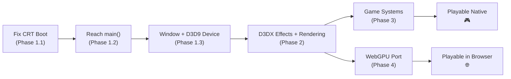

# Roadmap: ProStreet Running Natively on Linux & in the Browser

> This is the actionable plan to get from the current state (boot stops at CRT constructor 13) to a playable game — first natively on Linux, then in the browser via WebGPU.

---

## Where We Are Now

```
x86 → C lift ✅  47,514 functions lifted
Runtime build ✅  compiles clean with -Werror
Imports bound ✅  371/371 across 15 DLLs
Shader pipeline ✅  591/591 D3D9 → WGSL, all validate
D3D9 HLE ✅  device + buffers + draw + textures (test-level)
WebGPU triangle ✅  renders in Chrome
Web build ✅  compiles to 57 MB .wasm

Boot sequence ⛔  STOPS at static constructor 13 of 2,811
main() ❌  never reached
D3DX HLE ❌  all 14 imports stubbed (return 0)
Game systems ❌  files, audio, input, menus, racing — not started
```

---

## Phase 1 — Fix the Boot (Native Linux)

**Goal:** `./out/prostreet` runs past CRT init, reaches `main()`, creates a window.

### 1.1 Fix the CRT Constructor Crash

The boot stops inside `_initterm_e` at function `0x00435390` — a stale allocator pointer (`0xb4dd14 → 0x2aed0020`) from `.data` causes a SIGSEGV.

| Task | File(s) | Details |
|---|---|---|
| Trace the failing constructor to identify what it initialises | `debug/ctor13-dispatch-analysis.md` | Constructor 13 reads a game-global pool allocator; the `.data` section carries a stale pointer from the original process |
| Fix `.data` initialisation for pool allocator globals | `lifter/runtime/win32.c` | Either zero-init the relevant `.data` region or implement the pool allocator's init path |
| Increase `gh_alloc` arena headroom | `lifter/runtime/win32.c` | Current `heap_brk` at `0x200006e0` may exhaust before the game's allocator takes over |
| Verify all 2,811 `_initterm` constructors run | `scripts/run_boot.sh` | Check `out/boot.log` for `_initterm: 2811/2811 constructors ran` |

**Done when:** `./out/prostreet artifacts/nfs.exe.unpacked` completes CRT init, all constructors run, no SIGSEGV.

### 1.2 Reach `main()`

| Task | File(s) | Details |
|---|---|---|
| Ensure `_WinMainCRTStartup` → `WinMain` control flow completes | `lifter/runtime/win32.c` | After CRT init, the entry stub calls `WinMain(hInstance, 0, cmdline, SW_SHOW)` |
| Implement `GetCommandLineA` / `GetModuleHandleA` if not already functional | `lifter/runtime/win32.c` | Already implemented — verify they return sane values |
| Add `main-entry` log line at guest `WinMain` entry | `lifter/runtime/boot.c` | Log when EIP reaches the game's `WinMain` |

**Done when:** `grep 'main-entry' out/boot.log` shows the game reached `WinMain`.

### 1.3 Create a Window & D3D9 Device

| Task | File(s) | Details |
|---|---|---|
| Implement `CreateWindowExA` → create a real X11/Wayland window (or headless surface) | `lifter/runtime/win32.c` | Currently stubbed; need to return a valid HWND and optionally open an SDL/X11 window |
| Implement `Direct3DCreate9` → return a valid `IDirect3D9` stub | `lifter/runtime/win32.c` | Currently returns 0 — game cannot create a device |
| Implement `IDirect3D9::CreateDevice` → return an `IDirect3DDevice9` stub | `lifter/runtime/win32.c` or new `d3d9_hle.c` | COM vtable dispatch; return a fake device with working vtable |
| Implement basic `IDirect3DDevice9` methods: `BeginScene`, `EndScene`, `Present`, `Clear` | `lifter/runtime/d3d9_hle.c` (new) | Minimal stubs that log and return `D3D_OK` |

**Done when:** `./out/prostreet` creates a window, creates a D3D9 device, and reaches the first `BeginScene`/`EndScene` pair.

---

## Phase 2 — First Rendered Frame (Native Linux)

**Goal:** A single frame of the game renders to a window on Linux.

### 2.1 D3DX Effect System

| Task | File(s) | Details |
|---|---|---|
| Port `D3DXCreateEffectFromResourceA` from reference | `lifter/runtime/d3dx_hle.c` (new) | Create effect stub object, return fake pointer; reference: `reference/nfsu2-web/runtime/d3dx_hle.c` |
| Port `D3DXCreateEffectPool` | `lifter/runtime/d3dx_hle.c` | Minimal stub |
| Implement `ID3DXEffect::BeginPass` / `CommitChanges` | `lifter/runtime/d3dx_hle.c` | The core render path — sets shader constants, binds textures |
| Implement D3DX math: `D3DXMatrixMultiply`, `D3DXMatrixTranspose`, `D3DXMatrixInverse`, `D3DXMatrixMultiplyTranspose`, `D3DXVec3Transform`, `D3DXVec4Transform` | `lifter/runtime/d3dx_hle.c` | Pure C matrix/vector math — straightforward |

### 2.2 Rendering Pipeline

| Task | File(s) | Details |
|---|---|---|
| Implement `SetVertexShader` / `SetPixelShader` → track active shader | `lifter/runtime/d3d9_hle.c` | Store the shader handle; apply it at draw time |
| Implement `SetRenderState`, `SetSamplerState`, `SetTextureStageState` → track state | `lifter/runtime/d3d9_hle.c` | State table, applied at draw time |
| Implement `DrawPrimitive` / `DrawIndexedPrimitive` → render via OpenGL/Vulkan | `lifter/runtime/d3d9_hle.c` | Use SDL2 + OpenGL 3.3 (or Vulkan) as the native backend; translate vertex/index buffers |
| Implement `CreateVertexBuffer` / `CreateIndexBuffer` / `Lock` / `Unlock` | `lifter/runtime/d3d9_hle.c` | Allocate host-side buffers, map guest pointers |
| Implement `CreateTexture` / `SetTexture` / `LockRect` / `UnlockRect` | `lifter/runtime/d3d9_hle.c` | Load texture data from guest memory into GPU textures |

### 2.3 Shader Execution (Native Path)

| Task | File(s) | Details |
|---|---|---|
| At draw time, translate the active D3D9 shader bytecode → GLSL (or use the CPU interpreter) | `lifter/tools/shader2wgsl.c` (adapt for GLSL) or new `shader2glsl.c` | 591 shaders already parse; need a GLSL backend or use the existing WGSL → naga → SPIR-V pipeline |
| Wire shader constants from `SetVertexShaderConstantF` / `SetPixelShaderConstantF` | `lifter/runtime/d3d9_hle.c` | Copy constant registers to uniform buffers |

**Done when:** `./out/prostreet` renders at least one frame with geometry visible (even if textures/effects are wrong).

---

## Phase 3 — Game Systems (Native Linux)

**Goal:** The game is interactive — menus work, a race loads.

| System | Task | Details |
|---|---|---|
| **File I/O** | Implement `CreateFileA` → map game asset paths to `game/` directory | Already partially done; needs EA's `.bff` archive reading |
| **Audio** | Implement `DirectSoundCreate` / `IDirectSoundBuffer` → SDL_audio or PipeWire | 1 `dsound.dll` import; need buffer creation + playback |
| **Input** | Implement `DirectInput8Create` / `IDirectInputDevice8` → SDL_GameController or evdev | 1 `dinput8.dll` import; keyboard + gamepad |
| **Registry** | Implement `RegOpenKeyExA` / `RegQueryValueExA` → read from `app/registry-defaults.txt` | Already have the defaults file |
| **Networking** | Implement winsock stubs (`ws2_32.dll`, 37 imports) → return errors / no-network | Already implemented; verify LAN code doesn't crash |
| **Menus** | Debug and fix the game's menu init path | Depends on D3D9 HLE + file I/O being functional |

**Done when:** Game reaches main menu, player can navigate menus, and a race loads.

---

## Phase 4 — Browser Port (WebGPU + WebAssembly)

**Goal:** The game runs in a Chromium browser tab using WebGPU.

> This phase builds on Phase 2 — the native D3D9 HLE translates directly to the web runtime.

### 4.1 Web Runtime

| Task | File(s) | Details |
|---|---|---|
| Port CRT constructor fixes to wasm runtime | `web/runtime/` | Same `.data` init fixes from Phase 1 |
| Port `Direct3DCreate9` + `IDirect3DDevice9` to WebGPU backend | `web/runtime/web/gpu_web.c` | Already has encoder + proto infrastructure; wire up device creation |
| Port D3DX HLE to wasm | `web/runtime/web/` (new files) | Same C code, compiled to wasm |
| Wire shader pipeline: D3D9 bytecode → WGSL (already done!) → WebGPU pipeline | `web/src/gpu/encoder.ts`, `web/src/gpu/wgsl.ts` | 591 shaders already translate; need to hook into the draw path |

### 4.2 Asset Delivery

| Task | File(s) | Details |
|---|---|---|
| Serve game files via the web server | `web/start.sh` | Already serves `game/` directory; need to handle `.bff` archive reads |
| Implement OPFS-based caching for game assets | `web/src/app/` | Cache extracted assets in browser storage |

### 4.3 Audio & Input

| Task | File(s) | Details |
|---|---|---|
| Implement Web Audio API backend | `web/runtime/web/audio_web.c`, `web/src/app/` | Replace DirectSound with Web Audio |
| Implement keyboard/gamepad input via browser APIs | `web/runtime/web/input_web.c`, `web/src/app/controls.ts` | Replace DirectInput with `KeyboardEvent` / Gamepad API |

### 4.4 Performance

| Task | Details |
|---|---|
| Profile WASM memory usage (4 GB limit) | 23 MB image + game assets must fit in wasm linear memory |
| Optimise shader compilation (591 shaders) | Pre-compile pipeline cache; lazy-load shaders |
| Multi-threaded execution | SharedArrayBuffer + Web Workers for game thread vs render thread |

**Done when:** Game runs in Chrome/Firefox, main menu is navigable, a race renders at >1 FPS.

---

## Phase 5 — Polish & Playability

| Task | Details |
|---|---|
| Frame rate optimisation | Target 30+ FPS in browser |
| Save/load game state | LocalStorage or IndexedDB |
| Full shader correctness | Per-shader rendered-output comparison against reference |
| Missing D3D9 features | Render targets, stencil, multi-pass effects |
| Sound mixing | Positional audio, engine sounds, music |
| Networking | LAN multiplayer via WebRTC (stretch goal) |

---

## Critical Path Summary



> **The single biggest blocker is Phase 1.1** — fixing the CRT constructor crash. Everything else flows from that. The shader pipeline and web build infrastructure are already solid; they just need a running game to feed them.
